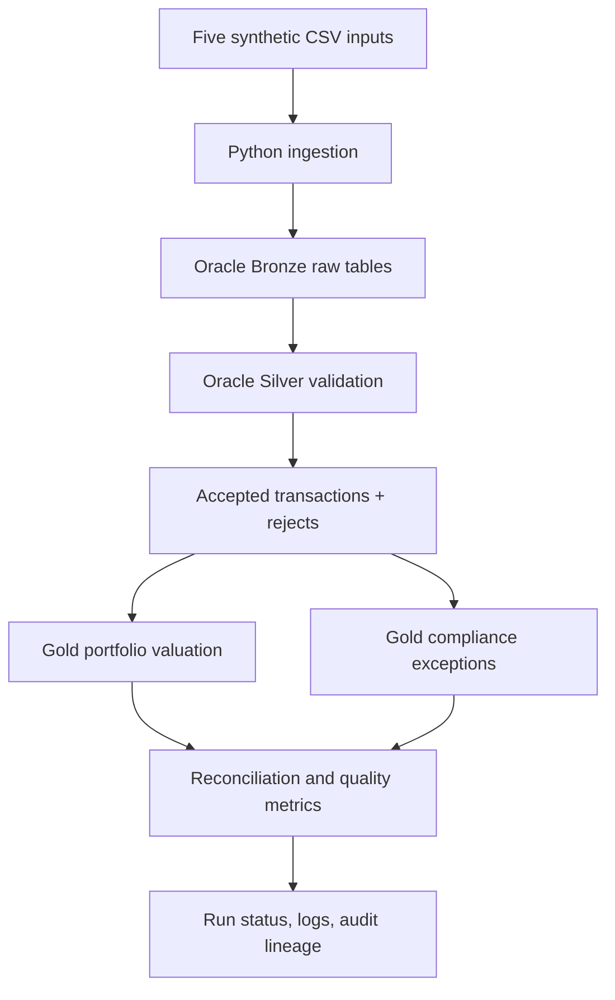

# Asset Management Data Pipeline

A small Oracle SQL + Python prototype for the Asset Management Data Pipeline case study.

It demonstrates:
- Bronze/raw ingestion of five synthetic source datasets
- Silver validation and rejection reasons
- Gold portfolio valuation and restricted-security exceptions
- Duplicate delivery and transaction idempotency controls
- Run-level reconciliation, audit lineage, controlled failure and replay
- Synthetic volume generation and simple performance measurements

> **Scope:** This is an interview/case-study prototype, not a production investment or regulatory reporting system. It uses synthetic data only. Review every assumption and be prepared to explain it.

## Architecture



Layers:
- **Bronze:** raw source rows and delivery metadata.
- **Silver:** accepted transactions plus record-level rejects.
- **Gold:** portfolio valuation, missing/stale price exceptions, and restricted-trade exceptions.
- **Operations:** run status, counts, source lineage, error details, elapsed time.

## Repository layout

```text
asset_management_data_pipeline/
├── README.md
├── requirements.txt
├── .env.example
├── .gitignore
├── src/
│   ├── __init__.py
│   ├── pipeline.py
│   └── generate_data.py
├── data/
│   ├── security_master.csv
│   ├── transactions.csv
│   ├── positions.csv
│   ├── market_prices.csv
│   └── restricted_securities.csv
├── tests/
│   └── test_data_quality.py
└── docs/
    └── engineering_decisions.md
```

**SQL scripts are intentionally not included in this GitHub repository, as requested. They remain in the original local ZIP/project folder.**

## Requirements

- Python 3.10+
- Oracle Database 19c+ (or compatible Oracle instance)
- Oracle account with permission to create tables and execute the SQL scripts retained locally
- Python packages listed in `requirements.txt`

## Setup

### 1. Create a virtual environment

Windows PowerShell:

```powershell
py -m venv .venv
.venv\\Scripts\\Activate.ps1
pip install -r requirements.txt
```

macOS/Linux:

```bash
python3 -m venv .venv
source .venv/bin/activate
pip install -r requirements.txt
```

### 2. Configure credentials

Copy `.env.example` to `.env` and set your Oracle connection details. Do not commit `.env`.

```text
DB_USER=your_user
DB_PASSWORD=your_password
DB_DSN=localhost:1521/FREEPDB1
```

The sample Python program reads environment variables. Load them into your shell before running, or use a local environment loader of your choice.

PowerShell example:

```powershell
$env:DB_USER="your_user"
$env:DB_PASSWORD="your_password"
$env:DB_DSN="localhost:1521/FREEPDB1"
```

### 3. Create schema

Execute the four SQL scripts from your local project copy in this order: `01_schema.sql`, `02_seed_reference_data.sql`, then run the pipeline, and use `04_demo_queries.sql` to inspect outputs. These SQL files are intentionally excluded from GitHub.

### 4. Run the pipeline

```bash
python -m src.pipeline --business-date 2026-10-29
```

Optional flags:

```bash
python -m src.pipeline --business-date 2026-10-29 --fail-after-load
python -m src.pipeline --business-date 2026-10-29 --force-replay
```

- `--fail-after-load` deliberately raises an error after the raw load, to demonstrate failure tracking. Re-run without the flag to replay.
- `--force-replay` skips the file-hash duplicate-delivery short circuit but still relies on transaction business keys to avoid duplicate accepted transactions. Use only for demonstration.

### 5. Inspect outputs

Use the local `04_demo_queries.sql` script. The Gold tables include:
- `GOLD_PORTFOLIO_POSITIONS`
- `GOLD_DATA_QUALITY_EXCEPTIONS`
- `GOLD_COMPLIANCE_EXCEPTIONS`
- `PIPELINE_RUNS`

## Test scenarios

1. **Successful run:** run the pipeline once and inspect output tables.
2. **Duplicate delivery:** run again with identical input; the delivery hash check skips the already-successful delivery.
3. **Transaction duplicate:** change a CSV to repeat a transaction ID; validation retains one identical record and quarantines conflicting versions.
4. **Missing price:** the S103 position has no price and appears in `GOLD_DATA_QUALITY_EXCEPTIONS`; it is not silently valued at zero.
5. **Restricted security:** T1002 is a trade in S102 while a restriction is active; inspect compliance output.
6. **Controlled failure and replay:** run with `--fail-after-load`, then rerun without it. Check run statuses and final counts.
7. **Volume:** use `python -m src.generate_data --rows 10000 --output data/transactions_large.csv`, then point the transaction path in your local run configuration to the generated file and compare elapsed time. Do not treat synthetic timing as a production benchmark.

## Business assumptions

- All data is synthetic.
- Quantities are signed: positive = buy/increase; negative = sell/decrease.
- Position rows are opening snapshots. Only transactions after the selected snapshot date and on/before the business date are applied.
- Market prices must be on or before the business date and no more than 3 calendar days old.
- This prototype assumes position, transaction and market price currencies are compatible; no FX conversion is implemented.
- A missing or stale price creates a Gold data-quality exception and withholds that valuation row.
- A restriction is applicable when status is `ACTIVE` and trade date is within the inclusive effective interval.
- The prototype uses one canonical transaction per transaction ID. Conflicting duplicate payloads are quarantined.
- Business date is passed explicitly, avoiding dependence on the machine's local clock.

## Security notes

- Never commit credentials or real client data.
- Use a least-privilege Oracle account.
- Use TLS/wallet settings appropriate to your Oracle environment.
- In production, rotate secrets, restrict logs, and apply retention/access policies.
- Add database grants, encryption, secret management and audit policies before production use.

## Known prototype limitations

- No FX conversion, corporate actions, settlement logic, accrued interest, multi-currency valuation, or regulatory sign-off.
- The sample transaction loader is designed for a small assessment dataset; use bounded batches for large inputs.
- Concurrency and orchestration locks need strengthening for simultaneous runs.
- Production should publish a complete run atomically and have stronger schema evolution/versioning controls.
- Price and restriction precedence policies should be agreed with business owners.
